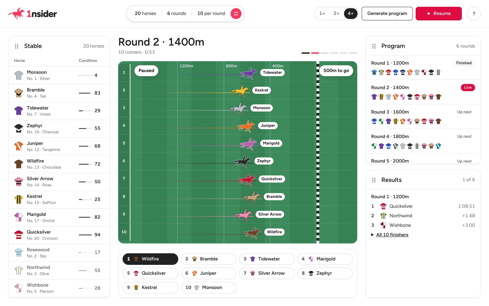
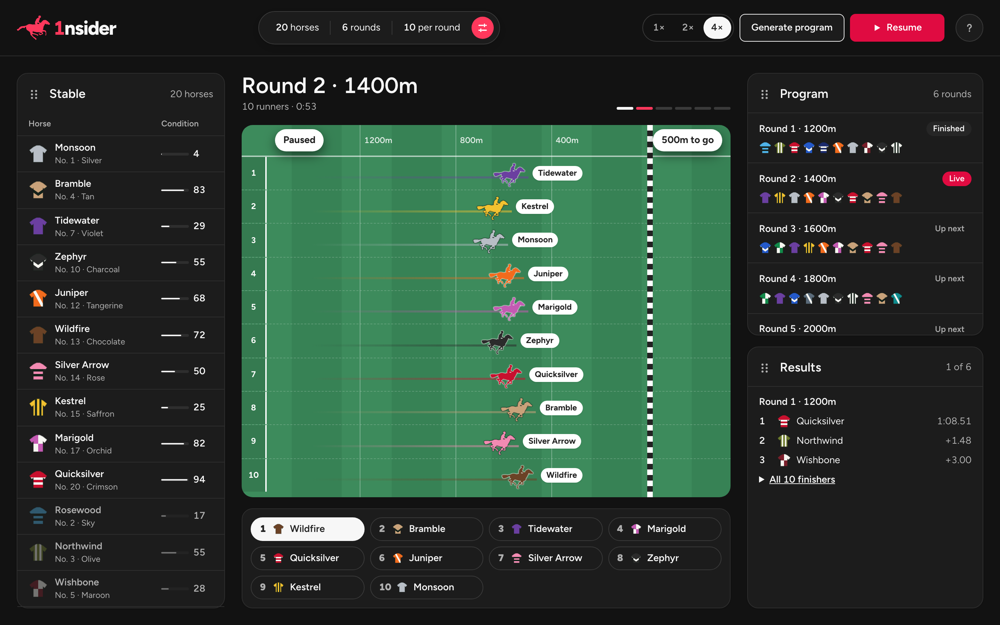
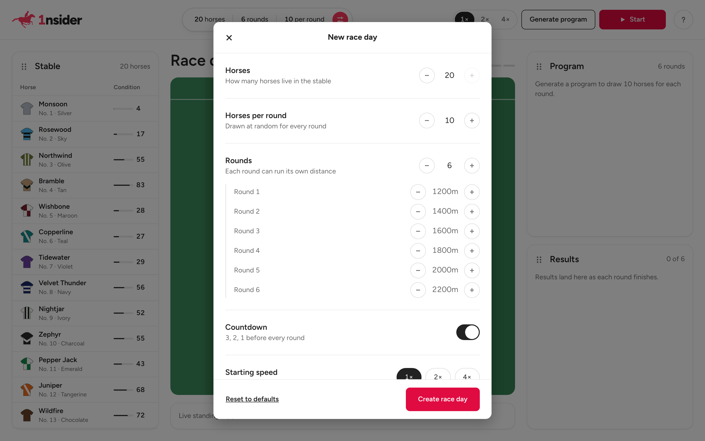
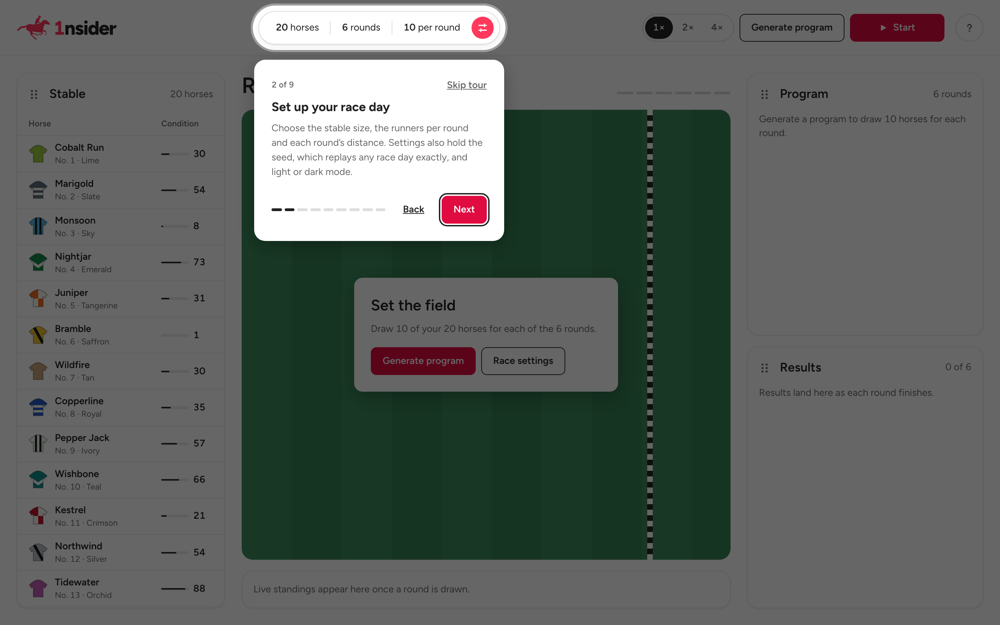
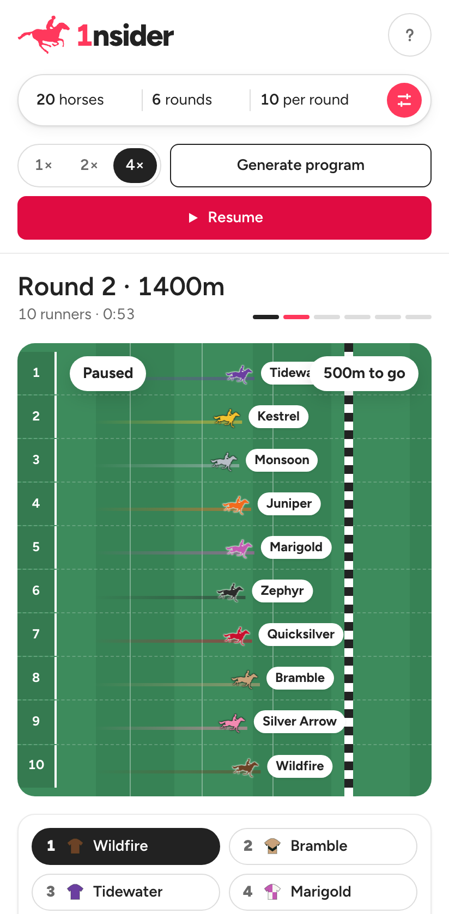
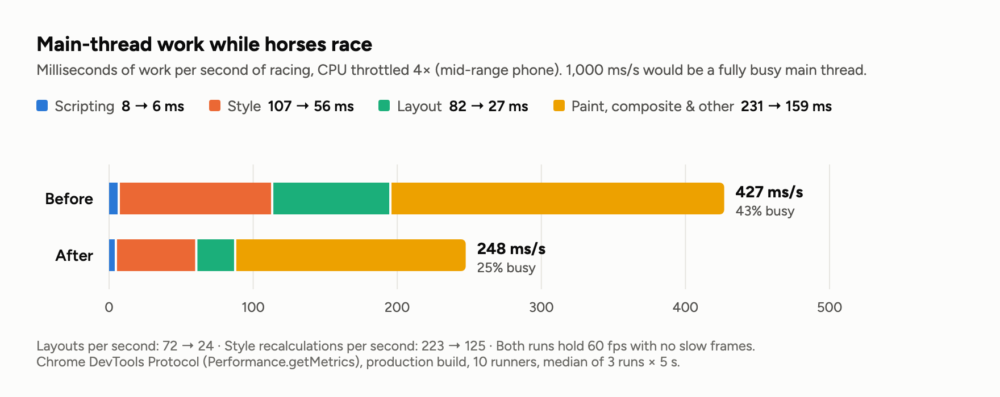

# 1nsider: a day at the races

[](https://github.com/alisahindev/insider-one-case-study/actions/workflows/ci.yml)

An interactive horse racing game built with Vue 3, Pinia and TypeScript for the Insider One Software Developer Assessment. A stable of horses is generated, a six-round program is drawn, and the rounds run one after another while the horses gallop across the track and the results come in.

**Live demo: [alisahindev.github.io/insider-one-case-study](https://alisahindev.github.io/insider-one-case-study/)**



## Run it

```bash
npm ci
npm run dev        # http://localhost:5173
```

Node 22.18+ or 24.12+. Other scripts are listed at the end.

## The brief, and where each part lives

Every row has a Playwright test named after the PDF item in [`e2e/requirements.spec.ts`](e2e/requirements.spec.ts), run on desktop and on a Pixel 7.

| Brief                                                      | Where                                                                                                                              |
| ---------------------------------------------------------- | ---------------------------------------------------------------------------------------------------------------------------------- |
| Vue                                                        | Vue 3.5, `<script setup lang="ts">` throughout                                                                                     |
| Horse list of 1 to 20 horses, randomly generated           | [`domain/horses.ts`](src/features/race/domain/horses.ts): names, colours and conditions are drawn fresh for each race day          |
| Generate creates a 6-round schedule                        | [`stores/race.ts`](src/features/race/stores/race.ts) `generate()`, [`domain/schedule.ts`](src/features/race/domain/schedule.ts)    |
| Start runs the races one round at a time                   | `start()`, `tick()` and `finishRound()` in the race store                                                                          |
| Results appear in the Results area as each race ends       | [`ResultsPanel.vue`](src/features/race/components/ResultsPanel.vue), newest first                                                  |
| Horses visibly move                                        | [`RaceTrack.vue`](src/features/race/components/RaceTrack.vue), [`RunnerFigure.vue`](src/features/race/components/RunnerFigure.vue) |
| Clean, maintainable code for a large project               | Feature folders and a framework-free domain layer (see [How it's built](#how-its-built))                                           |
| 20 horses, each with a unique colour and a 1–100 condition | `DEFAULT_SETTINGS`, `HORSE_COLORS` (20 named colours, also written out for colour-blind players)                                   |
| 6 rounds of 10 random horses out of 20                     | `createSchedule` samples without replacement                                                                                       |
| Rounds of 1200, 1400, 1600, 1800, 2000 and 2200 m          | `DEFAULT_SETTINGS.distances`                                                                                                       |
| Vuex or Pinia                                              | Five Pinia setup stores                                                                                                            |
| Component-based design                                     | 15 single-file components                                                                                                          |
| Bonus: unit, E2E and visual tests                          | 599 Vitest tests, 150 Playwright tests, visual baselines for macOS and Linux                                                       |

The brief's rules are the app's **defaults**. The setup dialog can change them (1–20 horses, runners per round, 1–10 rounds, the distance of each round), which is also how I'd expect the feature to grow.

## Beyond the brief

- **Setup dialog.** Stable size, runners per round, rounds and their distances, a countdown toggle, starting speed, appearance and an optional seed. Choices are remembered between visits.
- **Seeds and replays.** Every race day comes from a six-digit seed. The same seed rebuilds the same stable, program and results, and `?seed=48213` opens that exact day.
- **Movable panels.** Drag Stable, Program and Results between the side columns, or focus a panel's handle and use the arrow keys. The layout is saved.
- **Light and dark mode.** It follows the device or a choice in the settings, and the saved theme is applied before first paint, so there is no white flash.
- **Onboarding tour.** On the first visit, a nine-step spotlight tour shows each part of the screen. It can be skipped and replayed from the **?** button.
- **Live standings and controls.** Positions update as horses overtake each other. Speed is 1×, 2× or 4×, and you can pause mid-round.
- **Keyboard shortcuts.** <kbd>Space</kbd> starts or pauses, <kbd>G</kbd> draws a program, <kbd>1</kbd> <kbd>2</kbd> <kbd>4</kbd> set the speed.
- **Muybridge horses.** The runners are Eadweard Muybridge's 1878 _Horse in Motion_ frames, tinted per horse with a CSS mask. The logo is traced from the same frame.

| Dark mode                                    | Setup                                              | Tour                                                     | Phone                                        |
| -------------------------------------------- | -------------------------------------------------- | -------------------------------------------------------- | -------------------------------------------- |
|  |  |  |  |

## How it's built

**Stack:** Vue 3.5, Pinia 4, TypeScript, Vite 8, vue-draggable-plus (SortableJS) for panel drag, self-hosted Figtree. Vitest with Vue Test Utils, Playwright with axe-core. About 57 KB of gzipped JavaScript.

```
src/
├── main.ts                 boot: Pinia, theme, deep link, splash, first-visit tour
├── App.vue                 page shell: header, track, two panel columns
├── styles/                 design tokens (light and dark) and base styles
├── shared/                 NumberStepper, theme store
└── features/
    ├── race/
    │   ├── domain/         plain TypeScript, no Vue: RNG, horses, schedule, race maths, settings
    │   ├── stores/         race (the game), settings (remembered form choices)
    │   ├── composables/    useRaceLoop (requestAnimationFrame)
    │   ├── components/     track, panels, controls, setup dialog…
    │   └── utils/
    ├── layout/             movable panels: store + panel header
    └── onboarding/         tour steps, store, overlay
```

Dependencies point one way: **domain → stores → components**. The domain layer doesn't import Vue, so the simulation is tested on its own and could move to a worker or a server unchanged. Features own their folders, so one can be removed or handed to another team without touching the rest.

### State

The race store keeps as little as possible and derives the rest. The stable, the program, each round's runners, the final placings and the live standings are all `computed` from two seeds and the settings. One seed therefore reproduces a whole race day, and the views can't drift out of sync.

```
idle ──generate──▶ ready ──start──▶ racing ⇄ paused
  └────────start (draws first)────────┘   │
                         last round ends ─▶ finished ──start──▶ new program
```

The other stores are small: `settings` (remembered form choices; the seed is never stored), `layout` (which panel sits where), `theme` and `tour`. Anything read from `localStorage` or the URL is validated before it reaches state, and storage errors (private mode, quota) never break the app.

### The race

Each horse's speed is a function of time: a base pace from its condition, a ±4% daily form, two slow surges and linear fatigue. The **position is the closed-form integral** of that curve, and the finish time is found by bisection. So:

- Results don't depend on frame rate, and a hidden tab can't skew a race.
- The placings are known when a round starts. The animation only shows them, so the live order and the result always agree.
- The best-conditioned horse is the favourite, not a certainty.

`useRaceLoop` drives the store from `requestAnimationFrame` only while a race is running, with the step capped at 0.1 s so a backgrounded tab resumes instead of jumping ahead.

## Tests

```bash
npm run test:unit        # Vitest, watch mode
npm run test:coverage    # Vitest with coverage
npm run test:e2e         # Playwright, desktop + Pixel 7, against the production build
```

| Layer                      | Tests      | Notes                                                                                                                           |
| -------------------------- | ---------- | ------------------------------------------------------------------------------------------------------------------------------- |
| Unit: domain, stores, loop | 405        | Seeded RNG, race maths, settings normalisation against hostile input, every store action, corrupted and throwing `localStorage` |
| Components                 | 194        | Mounted against real Pinia stores and driven through their public actions, not mocks                                            |
| E2E                        | 150        | One test per brief item, flows and edge cases (1×1 to 20×10 days, seeds, persistence, drag and keyboard moves, the tour)        |
| Accessibility              | inside E2E | axe WCAG 2 A/AA scans with zero violations in five states, light and dark                                                       |
| Visual                     | inside E2E | Seven screens per device, with a fixed seed and a paused clock                                                                  |

Vitest coverage: 100% lines and functions, 99.8% statements, 98.8% branches.

Fonts render slightly differently per OS, so visual baselines exist for macOS and for Linux. The Linux ones come from the official Playwright image (`npm run test:visual:linux`), the same image CI runs in. The tests also found six real bugs, all fixed. The most interesting: `Number(null) === 0` was turning "no seed" into seed 0, so every race day after using the setup dialog had the same horses.

## Performance

Measured over the Chrome DevTools Protocol on the production build, CPU throttled 4× (a mid-range phone), median of three runs.



| While racing        | Before   | After   |
| ------------------- | -------- | ------- |
| Main thread busy    | 43%      | 25%     |
| Layouts per second  | 72       | 24      |
| Style recalculation | 107 ms/s | 56 ms/s |
| Frame rate          | 60 fps   | 60 fps  |

Horses, trails and sprite frames move with `transform` only. The rest came from measuring:

- Race time runs six times faster than wall time, so even a tenths-of-a-second clock changed every frame and forced a layout. The live clock now shows whole seconds, and the "to go" chip moves in 50 m steps.
- `--progress` is registered with `@property { inherits: false }` and set only on the two elements that read it, so a frame no longer restyles everything inside each runner.
- The live standings list re-renders only when the order changes, not every frame.

On load, locally: FCP 48 ms, LCP 84 ms, CLS 0.0001.

## Accessibility

- Native `<dialog>` for the setup and the tour: focus trap, <kbd>Esc</kbd>, and focus returns where it was.
- Everything works from the keyboard, including moving panels. Shortcuts are announced with `aria-keyshortcuts`.
- Round results, panel moves and tour steps are announced through `aria-live`.
- Semantic `<meter>`, `<details>`, `<output>` and tables. Colour is never the only cue, since every horse's colour is also named.
- `prefers-reduced-motion` turns animations and transitions off.

## Decisions and assumptions

- **"1 to 20 horses" and "a total of 20 horses"** both appear in the brief. The default is exactly 20 with 10 per round; the setup dialog allows 1–20.
- **A race is the whole day of six rounds**, and a round is a single run.
- **Results show newest first**, since the round that just finished is the one people look for.
- **No UI, animation or tour library.** Native `<dialog>`, CSS and Vue's transitions covered it, and the look stayed fully custom.
- **The design language is inspired by Airbnb's** (Rausch red, soft surfaces, pill controls). The project has no affiliation with Airbnb.

## Scripts

| Script                                   | What it does                             |
| ---------------------------------------- | ---------------------------------------- |
| `npm run dev`                            | Dev server                               |
| `npm run build`                          | Type-check and production build          |
| `npm run preview`                        | Serve the build on port 4173             |
| `npm run test:unit` / `test:coverage`    | Vitest                                   |
| `npm run test:e2e`                       | All Playwright tests                     |
| `npm run test:visual`                    | Visual tests only                        |
| `npm run test:visual:linux`              | Regenerate the Linux baselines in Docker |
| `npm run type-check` / `lint` / `format` | vue-tsc, oxlint + ESLint, Prettier       |

CI ([`.github/workflows/ci.yml`](.github/workflows/ci.yml)) runs type-check, lint, format, unit tests and the build. The Playwright suite runs in the Playwright container, and every green push to the default branch is deployed to GitHub Pages.

## Credits

- Horse frames: Eadweard Muybridge, _The Horse in Motion_ (1878), public domain, via the CC0 [running horse set on OpenGameArt](https://opengameart.org/node/32501).
- [Figtree](https://github.com/erikdkennedy/figtree) by Erik Kennedy, SIL Open Font License.
